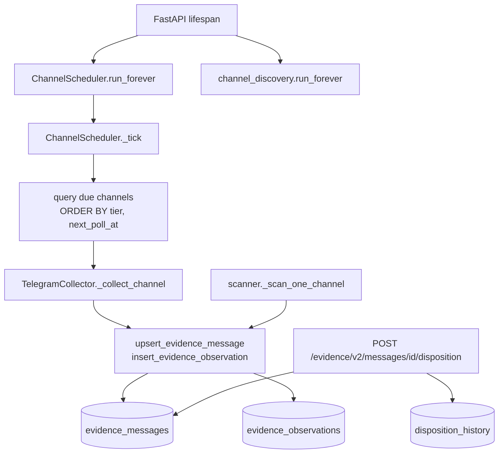

# Design Document: Scheduler Rebuild and Evidence Model

## Overview

This design covers two related changes to TeleMonitor:

1. **Priority scheduler** — a new `ChannelScheduler` class replaces the sequential sleep-per-channel loop in `TelegramCollector`. It runs a tick every `COLLECTOR_SCHEDULER_INTERVAL` seconds, queries channels whose `next_poll_at` is due, and dispatches up to `COLLECTOR_MAX_CONCURRENT` concurrent poll tasks. Priority ordering (HIGH before MEDIUM before LOW) ensures fast-tier channels are never starved by a large LOW queue.

2. **Two-level evidence model** — `scan_evidence` is a single upsert table that overwrites fields (including disposition) on every re-scan. The replacement is two tables: `evidence_messages` (one row per real Telegram message, never overwritten) and `evidence_observations` (one row per classification event, always inserted). Both the continuous-monitor collector and the scan-job scanner write to this model. Existing `scan_evidence` rows are migrated during `init_db()`.

No existing tables are dropped. No Alembic is involved. All schema changes use the existing `_migrate_sqlite_columns` / `CREATE TABLE IF NOT EXISTS` pattern.

---

## Architecture



The key dependency inversion: `ChannelScheduler` holds a reference to the `TelegramClient` and calls `TelegramCollector._collect_channel` directly. `TelegramCollector` retains `start()`, `stop()`, `client`, `_collect_channel()`, and `_process_message()`. Its `run_forever()` is removed.

---

## Components and Interfaces

### 1. `app/core/config.py` — new settings

```python
COLLECTOR_MAX_CONCURRENT: int = 3
COLLECTOR_SCHEDULER_INTERVAL: int = 10
MAX_BACKOFF_SECONDS: int = 3600
ERROR_BACKOFF_SECONDS: int = 3600
```

`POLL_INTERVAL_SECONDS` is retained for backwards compatibility.

### 2. `app/db/models.py` — new ORM models

**`EvidenceMessage`** — canonical record for one Telegram message:

| Column | Type | Notes |
|---|---|---|
| `id` | Integer PK | autoincrement |
| `channel_username` | VARCHAR(255) | NOT NULL |
| `telegram_message_id` | BIGINT | NOT NULL |
| `message_timestamp` | DATETIME | nullable |
| `raw_text` | TEXT | nullable |
| `caption_text` | TEXT | nullable |
| `ocr_text` | TEXT | nullable |
| `normalised_text` | TEXT | nullable |
| `extracted_identifiers` | TEXT | JSON array, nullable |
| `media_path` | TEXT | nullable |
| `media_hash` | VARCHAR(64) | nullable |
| `ocr_outcome` | VARCHAR(16) | `not_applicable\|skipped\|success\|failed` |
| `ocr_skip_reason` | VARCHAR(32) | nullable |
| `first_seen_at` | DATETIME | NOT NULL, DEFAULT now() |
| `last_seen_at` | DATETIME | NOT NULL, DEFAULT now() |
| `disposition` | VARCHAR(32) | nullable |
| `disposition_notes` | TEXT | nullable |
| `disposition_by` | VARCHAR(128) | nullable |
| `disposition_at` | DATETIME | nullable |

Unique constraint: `(channel_username, telegram_message_id)`.

**`EvidenceObservation`** — one row per classification event:

| Column | Type | Notes |
|---|---|---|
| `id` | Integer PK | autoincrement |
| `evidence_message_id` | Integer FK → `evidence_messages.id` | NOT NULL |
| `scan_job_id` | Integer FK → `scan_jobs.id` | nullable |
| `channel_scan_result_id` | Integer FK → `channel_scan_results.id` | nullable |
| `seed_profile_id` | Integer FK → `seed_profiles.id` | nullable |
| `query_variant_id` | Integer FK → `query_variants.id` | nullable |
| `source_type` | VARCHAR(32) | `scheduled_scan\|discovery\|pivot\|manual\|continuous_monitor` |
| `classifier_version` | VARCHAR(32) | DEFAULT `'lexicon_v1'` |
| `score` | REAL | NOT NULL |
| `risk_level` | VARCHAR(16) | NOT NULL |
| `severity_tier` | VARCHAR(16) | NOT NULL |
| `categories` | TEXT | JSON array |
| `matched_terms` | TEXT | JSON array |
| `classified_at` | DATETIME | NOT NULL, DEFAULT now() |

### 3. `app/db/database.py` — migration

`_migrate_sqlite_columns` additions:

```python
# channels table
("next_poll_at", "DATETIME"),

# evidence_messages and evidence_observations via CREATE TABLE IF NOT EXISTS
# in Base.metadata.create_all (handled automatically by SQLAlchemy)
```

`init_db()` also runs the `scan_evidence → evidence_messages/observations` migration SQL after `create_all`.

### 4. `app/db/crud.py` — new CRUD functions

```python
async def get_due_channels(db, now, limit) -> list[Channel]
    # SELECT WHERE is_active=1
    #   AND channel_status NOT IN ('inaccessible', 'paused', 'suspended')
    #   AND (next_poll_at IS NULL OR next_poll_at <= now)
    # ORDER BY CASE poll_tier WHEN 'HIGH' THEN 0 WHEN 'MEDIUM' THEN 1 ELSE 2 END,
    #          next_poll_at ASC NULLS FIRST
    # LIMIT limit

async def upsert_evidence_message(db, channel_username, telegram_message_id, **fields)
    -> EvidenceMessage
    # get-or-create on (channel_username, telegram_message_id)
    # On create: set first_seen_at = now
    # On update: update last_seen_at = now; update mutable fields;
    #            never overwrite disposition unless disposition kwarg is explicitly passed

async def insert_evidence_observation(db, evidence_message_id, **fields)
    -> EvidenceObservation
    # Always INSERT

async def get_evidence_message(db, evidence_message_id) -> EvidenceMessage | None

async def list_evidence_messages(
    db, channel_username=None, risk_level=None, disposition=None,
    date_from=None, date_to=None, skip=0, limit=100
) -> list[EvidenceMessage]
    # Subquery or join to pick latest observation per message for risk_level filter

async def get_observations_for_message(db, evidence_message_id)
    -> list[EvidenceObservation]
    # ORDER BY classified_at DESC

async def set_evidence_message_disposition(
    db, evidence_message_id, disposition, notes, changed_by
) -> EvidenceMessage | None
    # Writes to evidence_messages; inserts into disposition_history
```

### 5. `app/collectors/scheduler.py` — new file

```python
class ChannelScheduler:
    def __init__(self, client: TelegramClient) -> None:
        self._client = client
        self._semaphore = asyncio.Semaphore(settings.COLLECTOR_MAX_CONCURRENT)
        self._running_ids: set[int] = set()

    async def run_forever(self) -> None:
        while True:
            try:
                await self._tick()
            except Exception:
                logger.exception("Scheduler tick error")
            await asyncio.sleep(settings.COLLECTOR_SCHEDULER_INTERVAL)

    async def _tick(self) -> None:
        slots = settings.COLLECTOR_MAX_CONCURRENT - len(self._running_ids)
        if slots <= 0:
            return
        now = datetime.utcnow()
        async with get_session() as db:
            channels = await get_due_channels(db, now=now, limit=slots)
        for ch in channels:
            if ch.id in self._running_ids:
                continue
            self._running_ids.add(ch.id)
            asyncio.create_task(self._collect_one(ch))

    async def _collect_one(self, channel_row) -> None:
        # Calls TelegramCollector._collect_channel (or equivalent)
        # On success: update next_poll_at, reset error counters
        # On FloodWaitError: set next_poll_at with capped backoff, record health event
        # On ChannelPrivate/UsernameInvalid: set channel_status='inaccessible'
        # On N consecutive errors: set channel_status='error_state', ERROR_BACKOFF next_poll_at
        try:
            ...
        finally:
            self._running_ids.discard(channel_row.id)
```

### 6. `app/collectors/telegram_collector.py` — changes

- Remove `run_forever()`.
- Keep `start()`, `stop()`, `client` property, `_collect_channel()`, `_process_message()`.
- In `_process_message()`, after `save_alert()`, call `upsert_evidence_message` and `insert_evidence_observation` with `source_type='continuous_monitor'`.
- `get_collector()` unchanged.

### 7. `app/collectors/scanner.py` — changes

Replace `upsert_scan_evidence` calls in `_scan_one_channel` with:
```python
ev_msg = await upsert_evidence_message(db, channel_username=username,
    telegram_message_id=message_id, ...)
await insert_evidence_observation(db, evidence_message_id=ev_msg.id,
    source_type='scheduled_scan', scan_job_id=job_id,
    channel_scan_result_id=channel_scan_result_id, ...)
```

### 8. `app/api/evidence_v2.py` — new router

Mounted at `/evidence/v2/`. The existing `/evidence/` router is unchanged.

Endpoints:

| Method | Path | Description |
|---|---|---|
| `GET` | `/evidence/v2/messages/` | List with filters: `channel`, `date_from`, `date_to`, `disposition`, `risk_level`, `skip`, `limit` |
| `GET` | `/evidence/v2/messages/{id}` | Single message + latest observation |
| `GET` | `/evidence/v2/messages/{id}/observations` | All observations, `classified_at DESC` |
| `POST` | `/evidence/v2/messages/{id}/disposition` | Set disposition |

### 9. `app/main.py` — changes

```python
from app.collectors.scheduler import ChannelScheduler
# In lifespan:
collector = get_collector()
await collector.start()
_collector_task = asyncio.create_task(
    ChannelScheduler(collector.client).run_forever()
)
```

The existing discovery task starts independently, unchanged.

---

## Data Models

### `channels` table additions

| Column | Type | Default |
|---|---|---|
| `next_poll_at` | DATETIME | NULL |

Existing columns `poll_tier`, `channel_status`, `consecutive_error_count`, `error_state` are already present from the intelligence-platform spec.

### Evidence migration (inside `init_db()`)

```sql
-- Step 1 & 2: tables created by SQLAlchemy create_all

-- Step 3: migrate evidence_messages from scan_evidence
INSERT INTO evidence_messages (
    channel_username, telegram_message_id, message_timestamp,
    raw_text, normalised_text, extracted_identifiers,
    media_path, media_hash, ocr_skip_reason,
    disposition, disposition_notes, disposition_by, disposition_at,
    first_seen_at, last_seen_at
)
SELECT DISTINCT
    se.channel_username, se.telegram_message_id, se.message_timestamp,
    se.raw_text, se.normalised_text, se.extracted_identifiers,
    se.media_path, se.media_hash, se.ocr_skip_reason,
    se.disposition, se.disposition_notes, se.disposition_by, se.disposition_at,
    COALESCE(se.last_classified_at, datetime('now')),
    COALESCE(se.last_classified_at, datetime('now'))
FROM scan_evidence se
WHERE NOT EXISTS (
    SELECT 1 FROM evidence_messages em
    WHERE em.channel_username = se.channel_username
      AND em.telegram_message_id = se.telegram_message_id
);

-- Step 4: migrate evidence_observations from scan_evidence
INSERT INTO evidence_observations (
    evidence_message_id, scan_job_id, channel_scan_result_id, query_variant_id,
    source_type, score, risk_level, severity_tier,
    categories, matched_terms, classified_at
)
SELECT
    em.id,
    se.scan_job_id, se.channel_scan_result_id, se.query_variant_id,
    'scheduled_scan',
    se.classifier_score, se.risk_level, se.severity_tier,
    se.categories, se.matched_terms,
    COALESCE(se.last_classified_at, datetime('now'))
FROM scan_evidence se
JOIN evidence_messages em
  ON em.channel_username = se.channel_username
 AND em.telegram_message_id = se.telegram_message_id
WHERE NOT EXISTS (
    SELECT 1 FROM evidence_observations eo
    WHERE eo.evidence_message_id = em.id
      AND eo.scan_job_id = se.scan_job_id
      AND eo.classified_at = COALESCE(se.last_classified_at, datetime('now'))
);
```

---

## Correctness Properties

*A property is a characteristic or behavior that should hold true across all valid executions of a system — essentially, a formal statement about what the system should do. Properties serve as the bridge between human-readable specifications and machine-verifiable correctness guarantees.*

### Property 1: Scheduler query filters correctly

*For any* set of channels with varying `is_active`, `channel_status`, and `next_poll_at` values, `get_due_channels` SHALL return exactly the channels where `is_active = True`, `channel_status NOT IN ('inaccessible', 'paused', 'suspended', 'error_state')`, and `next_poll_at IS NULL OR next_poll_at <= now`.

**Validates: Requirements 1.2, 2.2**

### Property 2: Scheduler query respects tier priority

*For any* set of due channels spanning all three tiers, the channels returned by `get_due_channels` SHALL appear in order HIGH first, then MEDIUM, then LOW (ties within a tier ordered by `next_poll_at ASC`).

**Validates: Requirements 1.3**

### Property 3: FloodWait backoff is capped

*For any* `flood_wait_seconds` value, the `next_poll_at` offset set by the scheduler SHALL be `min(flood_wait_seconds, MAX_BACKOFF_SECONDS)` seconds from now.

**Validates: Requirements 3.1, 3.3**

### Property 4: Error counter increments and threshold triggers error_state

*For any* channel and any sequence of N consecutive non-FloodWait poll failures, `consecutive_error_count` SHALL equal N after those failures, and `channel_status` SHALL be `'error_state'` once N >= `ERROR_STATE_THRESHOLD`.

**Validates: Requirements 4.1, 4.2**

### Property 5: Success resets error state

*For any* channel currently in `error_state` with a non-zero `consecutive_error_count`, a successful poll SHALL reset `consecutive_error_count` to 0 and `channel_status` to `'active'`.

**Validates: Requirements 4.4, 3.4**

### Property 6: upsert_evidence_message preserves first_seen_at and disposition

*For any* `(channel_username, telegram_message_id)` pair, calling `upsert_evidence_message` a second time SHALL leave `first_seen_at` unchanged and SHALL NOT overwrite a non-null `disposition`, `disposition_notes`, `disposition_by`, or `disposition_at`.

**Validates: Requirements 6.4, 10.2**

### Property 7: insert_evidence_observation always adds a new row

*For any* sequence of N calls to `insert_evidence_observation` with the same `evidence_message_id`, the resulting row count in `evidence_observations` for that `evidence_message_id` SHALL equal N.

**Validates: Requirements 7.3**

### Property 8: Evidence list filter correctness

*For any* database state and any combination of `channel_username`, `risk_level`, `disposition`, `date_from`, `date_to` filter values, every row returned by `list_evidence_messages` SHALL satisfy all supplied filter predicates, and no row satisfying all predicates SHALL be absent from the result.

**Validates: Requirements 11.1, 11.2**

### Property 9: Observations returned in descending order

*For any* `evidence_message_id` with multiple observations, `get_observations_for_message` SHALL return them ordered by `classified_at DESC` such that `result[i].classified_at >= result[i+1].classified_at` for all valid `i`.

**Validates: Requirements 11.4**

### Property 10: Migration idempotency

*For any* initial `scan_evidence` dataset, running the `init_db()` migration SQL block N times (N >= 1) SHALL produce the same `evidence_messages` and `evidence_observations` row counts as running it once.

**Validates: Requirements 12.5**

---

## Error Handling

### Scheduler error taxonomy

| Error type | Action |
|---|---|
| `FloodWaitError` | Set `next_poll_at = now + min(e.seconds, MAX_BACKOFF_SECONDS)`. Record `flood_wait` health event. Do not increment `consecutive_error_count`. |
| `ChannelPrivateError` / `UsernameInvalidError` / `UsernameNotOccupiedError` | Set `channel_status = 'inaccessible'`, `next_poll_at = now + ERROR_BACKOFF_SECONDS`. Record health event. |
| Any other exception | Increment `consecutive_error_count`. If count >= `ERROR_STATE_THRESHOLD`, set `channel_status = 'error_state'`, `next_poll_at = now + ERROR_BACKOFF_SECONDS`. Record health event. |
| Success after any error | Reset `consecutive_error_count = 0`, `channel_status = 'active'`. |

The scheduler tick itself is wrapped in a broad `try/except` so a single-tick crash does not terminate `run_forever`.

### Evidence API error handling

- `GET /evidence/v2/messages/{id}` and all sub-paths: return HTTP 404 if `evidence_message_id` does not exist.
- `POST /evidence/v2/messages/{id}/disposition`: return HTTP 422 if `disposition` is not one of the allowed enum values.
- DB failures: propagate as HTTP 500 (FastAPI default).

### Migration error handling

The migration SQL runs inside `init_db()`. Each step is guarded with `NOT EXISTS` predicates making it safe to retry. A failure in the migration block is logged at WARNING level and does not abort startup — the system continues with whatever tables were successfully created.

---

## Testing Strategy

PBT is applicable here: the scheduler query logic, evidence upsert semantics, and filter logic all involve pure-function behavior over varying inputs.

**Property-based tests** (using [Hypothesis](https://hypothesis.readthedocs.io/)):
- Each correctness property above has one property-based test.
- Minimum 100 iterations per test.
- Tag format: `# Feature: scheduler-and-evidence-model, Property N: <property_text>`
- Test file: `backend/tests/test_scheduler_evidence_properties.py`

**Unit / example tests** (using pytest):
- `_migrate_sqlite_columns` adds `next_poll_at` to an existing in-memory SQLite DB.
- `init_db()` migration is idempotent across two runs on a seeded `scan_evidence` table.
- `PATCH /channels/{id}/poll-tier` resets `next_poll_at` to NULL.
- `GET /channels/` response includes `next_poll_at` and `channel_status` fields.
- `ChannelScheduler._tick()` does not launch tasks when no channels are due.
- `FloodWaitError` records a `flood_wait` health event.
- `ChannelPrivateError` sets `channel_status = 'inaccessible'`.
- `GET /evidence/v2/messages/{id}` returns HTTP 404 for unknown id.
- `POST /evidence/v2/messages/{id}/disposition` writes to `disposition_history`.
- Test file: `backend/tests/test_scheduler_evidence_examples.py`

**Integration tests** (manual or end-to-end):
- After migration, `evidence_messages` row count matches pre-migration `scan_evidence` count.
- Continuous monitor collector creates evidence rows visible via `GET /evidence/v2/messages/`.
